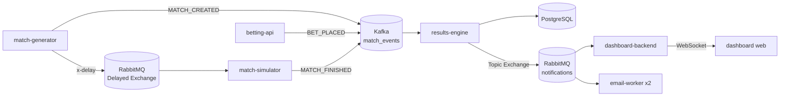

# LiveBet — Plataforma de Apuestas Deportivas en Vivo

Proyecto final de Computación Ubicua, **Grupo 3 de Sexto B**.

**Integrantes:** Luis Castillo, Bayron Jaramillo, Matheu Ruales y Carlos Burbano.

LiveBet genera partidos aleatorios, recibe apuestas por HTTP, cierra cada partido mediante un temporizador distribuido, liquida los resultados y actualiza un dashboard en tiempo real. Kafka conserva el log inmutable de eventos; RabbitMQ programa tareas y enruta notificaciones; PostgreSQL guarda la auditoría consolidada.

La experiencia web incluye registro e inicio de sesión, saldo demo individual, apuestas directamente desde cada partido, historial personal y un panel administrativo protegido por roles. Las contraseñas se almacenan con BCrypt y las sesiones se firman con HMAC-SHA256.

## Arquitectura



La clave de cada registro en `match_events` es el `match_id`. Kafka asigna todos los eventos del mismo partido a una partición y conserva su orden.

## Componentes

| Componente | Responsabilidad |
|---|---|
| `match-generator` | Crea partidos y programa su cierre con `x-delay` |
| `betting-api` | Valida, registra y publica `BET_PLACED` mediante Transactional Outbox |
| `match-simulator` | Consume el temporizador y elige el ganador |
| `results-engine` | Reconstruye agregados, aplica reglas, liquida y audita |
| `dashboard-backend` | Consume cambios y los transmite por WebSocket |
| `email-worker` | Envía por Gmail correos HTML de apuestas ganadas, perdidas o reembolsadas; usa dos réplicas competitivas |
| `shared-contracts` | Contratos inmutables entre servicios |
| `domain` | Modelo rico independiente de Spring y de los brokers |

## Inicio rápido

Requisitos: Docker Desktop o Docker Engine con Compose.

```bash
cp .env.example .env
docker compose up --build -d
```

En un Mac con procesador Apple Silicon, las imágenes Alpine solicitadas por el ejercicio se ejecutan mediante emulación:

```bash
DOCKER_DEFAULT_PLATFORM=linux/amd64 docker compose up --build -d
```

Espere a que los servicios estén saludables:

```bash
./scripts/verify.sh
```

Accesos locales:

- Dashboard: <http://localhost:8080>
- API de apuestas: <http://localhost:8081/api/bets>
Kafka, RabbitMQ y PostgreSQL permanecen únicamente en redes internas. Solo el dashboard y la API exponen puertos al host.

Despliegue de entrega verificado en AWS (18 de noviembre de 2026):

- Dashboard: <http://18.224.52.92:8080>
- API: <http://18.224.52.92:8081>

En esta versión se verificaron en la nube el registro, el inicio de sesión, la
autorización por roles, el panel administrativo, la consulta del historial y
una apuesta autenticada con débito de saldo.

La IP de EC2 no es elástica y puede cambiar después de detener la instancia. Consulte la guía de AWS para reproducir el despliegue.

Las credenciales de desarrollo se encuentran en `.env`. Cambie todos los secretos antes de desplegar.

## Realizar una apuesta

Desde el dashboard, cree una cuenta, seleccione cualquiera de los dos equipos de un partido abierto, elija el monto y confirme. Cada cuenta nueva recibe 250.000 COP de saldo demo.

El panel **Recargar saldo** usa Checkout Pro de Mercado Pago. LiveBet crea una orden en el servidor y redirige al usuario al sitio oficial de Mercado Pago; el saldo se acredita únicamente después de validar la firma del webhook y consultar la orden aprobada. Consulte la [guía de configuración](docs/mercado-pago.md). La recarga simulada anterior permanece en el código solo para desarrollo y está deshabilitada por defecto.

La cuenta administrativa inicial se configura mediante `ADMIN_EMAIL` y `ADMIN_PASSWORD`; nunca conserve las credenciales de ejemplo en un despliegue público.

### API de autenticación y usuarios

| Método | Ruta | Acceso | Uso |
|---|---|---|---|
| `POST` | `/api/auth/register` | Público | Crear una cuenta |
| `POST` | `/api/auth/login` | Público | Iniciar sesión y obtener token |
| `GET` | `/api/auth/me` | Token | Perfil y saldo actual |
| `POST` | `/api/bets` o `/bet` | Token | Registrar una apuesta |
| `GET` | `/api/bets` | Token | Historial personal |
| `GET` | `/api/recharges/payment-config` | Token | Consultar si Mercado Pago está habilitado |
| `POST` | `/api/recharges/checkout` | Token | Crear la orden y obtener el enlace de pago |
| `GET` | `/api/recharges/checkout/{reference}` | Token | Consultar el estado de una recarga |
| `GET` | `/api/admin/users` | ADMIN | Consultar usuarios |
| `PATCH` | `/api/admin/users/{id}/balance` | ADMIN | Recargar saldo |
| `PATCH` | `/api/admin/users/{id}/role` | ADMIN | Cambiar rol |
| `PATCH` | `/api/admin/users/{id}/active` | ADMIN | Activar o desactivar cuenta |

Primero copie del dashboard el identificador y el nombre exacto de un equipo abierto.

```bash
./scripts/demo-bet.sh m-12345678 "Cúcuta" user-101 10000
```

También puede usar HTTP directamente:

```bash
curl -X POST http://localhost:8081/api/bets \
  -H 'Content-Type: application/json' \
  -H 'Authorization: Bearer TOKEN_DE_SESION' \
  -d '{
    "matchId":"m-12345678",
    "betOn":"Cúcuta",
    "amount":10000
  }'
```

La API responde `202 Accepted` porque el motor valida la regla de negocio de forma asíncrona al consumir el evento.

## Flujo esperado

1. `match-generator` publica `MATCH_CREATED` en Kafka y un comando diferido en RabbitMQ.
2. `results-engine` reconstruye el agregado y publica el partido abierto.
3. El dashboard recibe el cambio por WebSocket.
4. `betting-api` guarda saldo, apuesta y evento pendiente en una sola transacción; el outbox publica después en Kafka con reintentos.
5. RabbitMQ entrega el comando cuando vence el tiempo.
6. `match-simulator` publica `MATCH_FINISHED`.
7. `results-engine` cierra el agregado, calcula pagos con cuota fija 2.0, persiste la auditoría y emite notificaciones.
8. Una réplica de `email-worker` envía al correo registrado el resultado, marcador, selección, monto, premio y códigos de seguimiento. Una apuesta tardía queda `REJECTED`, se reembolsa una sola vez y también se notifica.

Al iniciar, `results-engine` reproduce `match_events` desde `earliest` con un grupo nuevo. Los eventos auditados reconstruyen el estado y refrescan el dashboard, pero no vuelven a generar pagos, correos ni escrituras contables.

## Pruebas

Las pruebas no levantan Spring, bases de datos ni conexiones de red.

```bash
docker run --rm \
  -v maven-cache:/root/.m2 \
  -v "$PWD":/workspace -w /workspace \
  maven:3.9.9-eclipse-temurin-17 mvn -B test
```

Cubren invariantes del dinero, aceptación y rechazo de apuestas, transición de estados, cálculo de premios, persistencia y publicación de mensajes mediante Mockito.

## Evidencias útiles para la exposición

```bash
docker compose ps
docker compose logs -f match-generator match-simulator results-engine email-worker
docker compose exec postgres-db psql -U betting -d betting -c \
  'select id, home_team, away_team, winner, total_bet from matches order by closed_at desc;'
```

Los logs permiten observar el exchange diferido, las simulaciones, las liquidaciones y el reparto de notificaciones entre workers. La consola de RabbitMQ puede habilitarse temporalmente solo durante diagnóstico local.

## Correos de resultados

El envío utiliza SMTP autenticado con TLS. Para Gmail configure una contraseña de aplicación y manténgala únicamente en `.env`:

```dotenv
MAIL_ENABLED=true
MAIL_HOST=smtp.gmail.com
MAIL_PORT=587
MAIL_USERNAME=cuenta@gmail.com
MAIL_PASSWORD=contraseña_de_aplicación
MAIL_FROM_ADDRESS=cuenta@gmail.com
MAIL_FROM_NAME=LiveBet
```

`.env` está excluido de Git. Si el correo falla, RabbitMQ reintenta el mensaje y finalmente lo mueve a `email_notifications_dlq` para no perderlo silenciosamente.

## Detener el sistema

```bash
docker compose down
```

Para eliminar también el historial local:

```bash
docker compose down -v
```

El segundo comando elimina de forma irreversible el volumen de PostgreSQL.

## Documentación adicional

- [Centro de documentación](docs/README.md)
- [Documentación técnica completa](docs/documentacion-tecnica-completa.md)
- [Catálogo de diagramas](docs/diagramas.md)
- [Referencia de API y eventos](docs/referencia-api-y-eventos.md)
- [Modelo de datos](docs/modelo-de-datos.md)
- [Operación, despliegue y seguridad](docs/operacion-despliegue-seguridad.md)
- [Pruebas y trazabilidad](docs/pruebas-y-trazabilidad.md)
- [Manual de usuario y administrador](docs/manual-de-usuario.md)
- [Decisiones técnicas](docs/decisiones-tecnicas.md)
- [Modelo y pruebas](docs/modelo-y-pruebas.md)
- [Guía de demostración](docs/guia-demostracion.md)
- [Despliegue en AWS](docs/despliegue-aws.md)
- [Pipeline de GitHub Actions](docs/pipeline-github.md)
