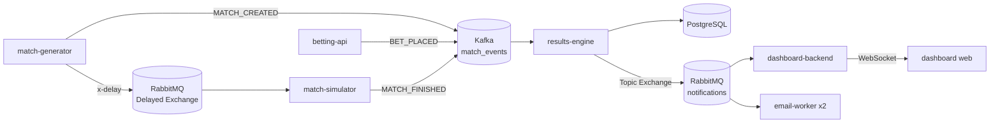

# LiveBet — Plataforma de Apuestas Deportivas en Vivo

Proyecto final de Computación Ubicua, **Grupo 3 de Sexto B**.

**Integrantes:** Luis Castillo, Bayron Jaramillo, Matheu Ruales y Carlos Burbano.

LiveBet genera partidos aleatorios, recibe apuestas por HTTP, cierra cada partido mediante un temporizador distribuido, liquida los resultados y actualiza un dashboard en tiempo real. Kafka conserva el log inmutable de eventos; RabbitMQ programa tareas y enruta notificaciones; PostgreSQL guarda la auditoría consolidada.

## Arquitectura



La clave de cada registro en `match_events` es el `match_id`. Kafka asigna todos los eventos del mismo partido a una partición y conserva su orden.

## Componentes

| Componente | Responsabilidad |
|---|---|
| `match-generator` | Crea partidos y programa su cierre con `x-delay` |
| `betting-api` | Valida la entrada y publica `BET_PLACED` |
| `match-simulator` | Consume el temporizador y elige el ganador |
| `results-engine` | Reconstruye agregados, aplica reglas, liquida y audita |
| `dashboard-backend` | Consume cambios y los transmite por WebSocket |
| `email-worker` | Procesa notificaciones con dos réplicas competitivas |
| `shared-contracts` | Contratos inmutables entre servicios |
| `domain` | Modelo rico independiente de Spring y de los brokers |

## Inicio rápido

Requisitos: Docker Desktop o Docker Engine con Compose.

```bash
cp .env.example .env
docker compose up --build -d
```

En un Mac con procesador Apple Silicon, las imágenes Alpine solicitadas por el ejercicio se ejecutan mediante emulación:

```bash
DOCKER_DEFAULT_PLATFORM=linux/amd64 docker compose up --build -d
```

Espere a que los servicios estén saludables:

```bash
./scripts/verify.sh
```

Accesos locales:

- Dashboard: <http://localhost:8080>
- API de apuestas: <http://localhost:8081/api/bets>
- RabbitMQ Management: <http://localhost:15672>
- Kafka externo: `localhost:9092`
- PostgreSQL externo: `localhost:55432`

Las credenciales de desarrollo se encuentran en `.env`. Cambie todos los secretos antes de desplegar.

## Realizar una apuesta

Primero copie del dashboard el identificador y el nombre exacto de un equipo abierto.

```bash
./scripts/demo-bet.sh m-12345678 "Cúcuta" user-101 10000
```

También puede usar HTTP directamente:

```bash
curl -X POST http://localhost:8081/api/bets \
  -H 'Content-Type: application/json' \
  -d '{
    "userId":"user-101",
    "matchId":"m-12345678",
    "betOn":"Cúcuta",
    "amount":10000
  }'
```

La API responde `202 Accepted` porque el motor valida la regla de negocio de forma asíncrona al consumir el evento.

## Flujo esperado

1. `match-generator` publica `MATCH_CREATED` en Kafka y un comando diferido en RabbitMQ.
2. `results-engine` reconstruye el agregado y publica el partido abierto.
3. El dashboard recibe el cambio por WebSocket.
4. `betting-api` registra las apuestas en Kafka.
5. RabbitMQ entrega el comando cuando vence el tiempo.
6. `match-simulator` publica `MATCH_FINISHED`.
7. `results-engine` cierra el agregado, calcula pagos con cuota fija 2.0, persiste la auditoría y emite notificaciones.
8. Una réplica de `email-worker` procesa cada mensaje y el dashboard muestra el resultado.

## Pruebas

Las pruebas no levantan Spring, bases de datos ni conexiones de red.

```bash
docker run --rm \
  -v maven-cache:/root/.m2 \
  -v "$PWD":/workspace -w /workspace \
  maven:3.9.9-eclipse-temurin-17 mvn -B test
```

Cubren invariantes del dinero, aceptación y rechazo de apuestas, transición de estados, cálculo de premios, persistencia y publicación de mensajes mediante Mockito.

## Evidencias útiles para la exposición

```bash
docker compose ps
docker compose logs -f match-generator match-simulator results-engine email-worker
docker compose exec postgres-db psql -U betting -d betting -c \
  'select id, home_team, away_team, winner, total_bet from matches order by closed_at desc;'
```

En RabbitMQ Management se observan el exchange diferido `match.delayed`, el exchange `notifications`, la cola de simulación y las colas de notificación.

## Detener el sistema

```bash
docker compose down
```

Para eliminar también el historial local:

```bash
docker compose down -v
```

El segundo comando elimina de forma irreversible el volumen de PostgreSQL.

## Documentación adicional

- [Decisiones técnicas](docs/decisiones-tecnicas.md)
- [Modelo y pruebas](docs/modelo-y-pruebas.md)
- [Guía de demostración](docs/guia-demostracion.md)
- [Despliegue en AWS](docs/despliegue-aws.md)
