# Catálogo de diagramas de LiveBet

Los siguientes diagramas representan la implementación actual. Mermaid permite revisarlos en GitHub y modificarlos junto con el código.

## 1. Contexto del sistema

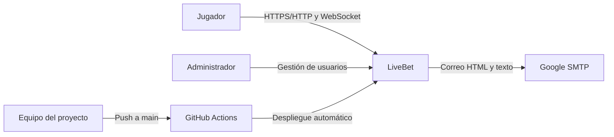

## 2. Arquitectura de contenedores

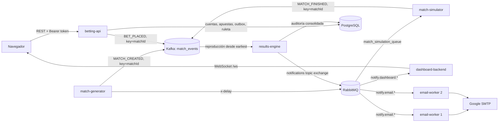

## 3. Topología Kafka y RabbitMQ

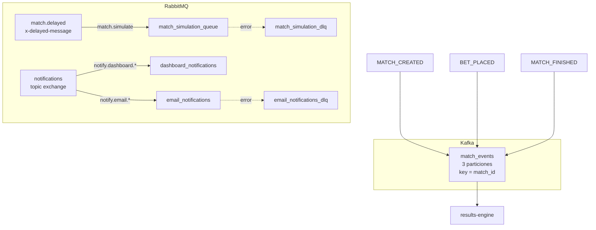

## 4. Diagrama de clases del dominio de partidos

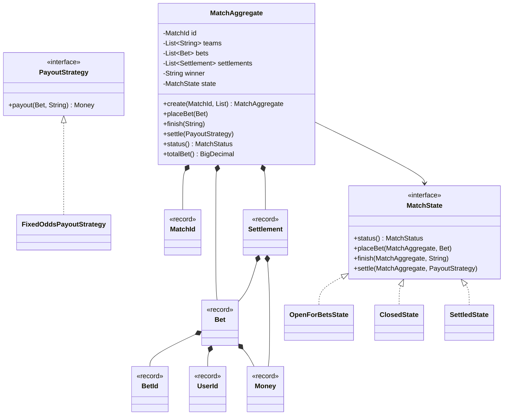

## 5. Clases y puertos del procesamiento de eventos

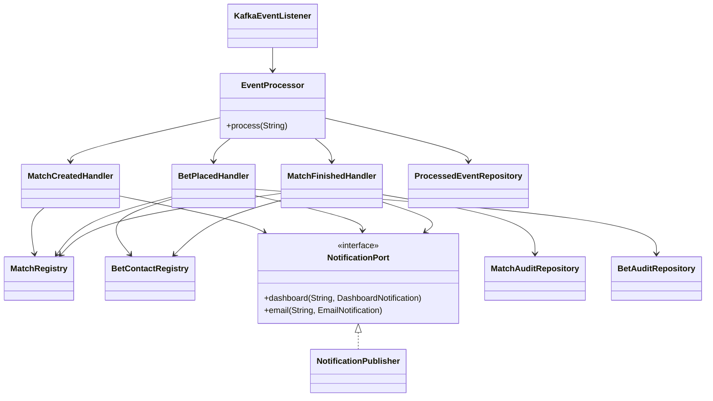

## 6. Clases principales de cuentas y apuestas

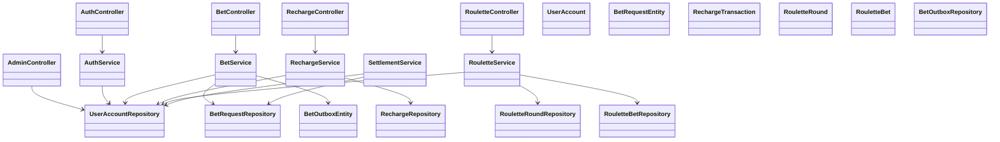

## 7. Máquina de estados del partido

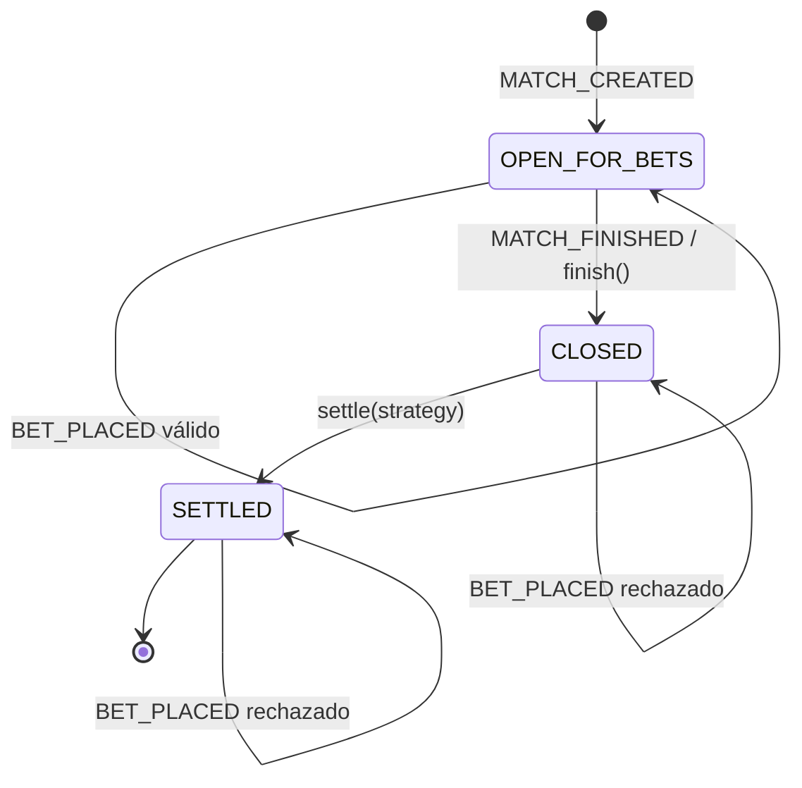

## 8. Secuencia completa de un partido

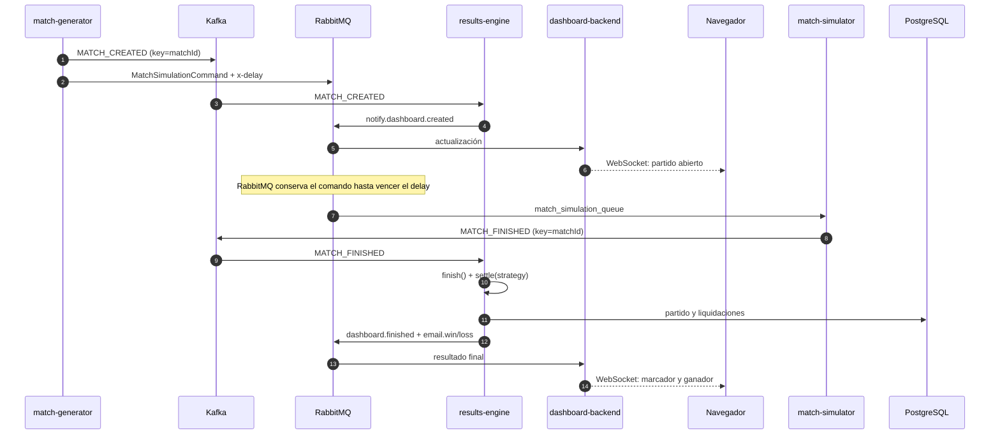

## 9. Secuencia de una apuesta con Transactional Outbox

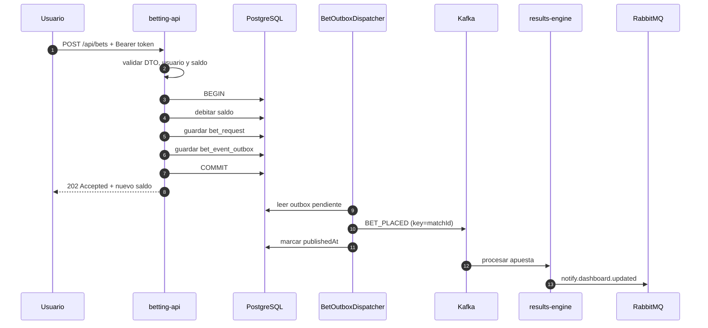

## 10. Apuesta tardía y reembolso

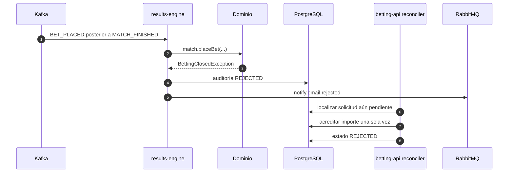

## 11. Recarga de saldo

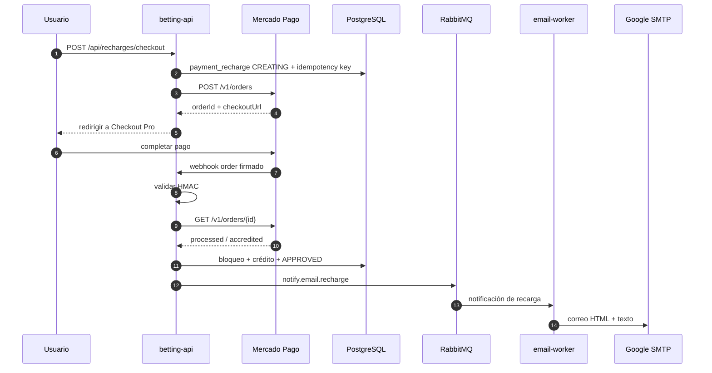

## 12. Ronda global de ruleta

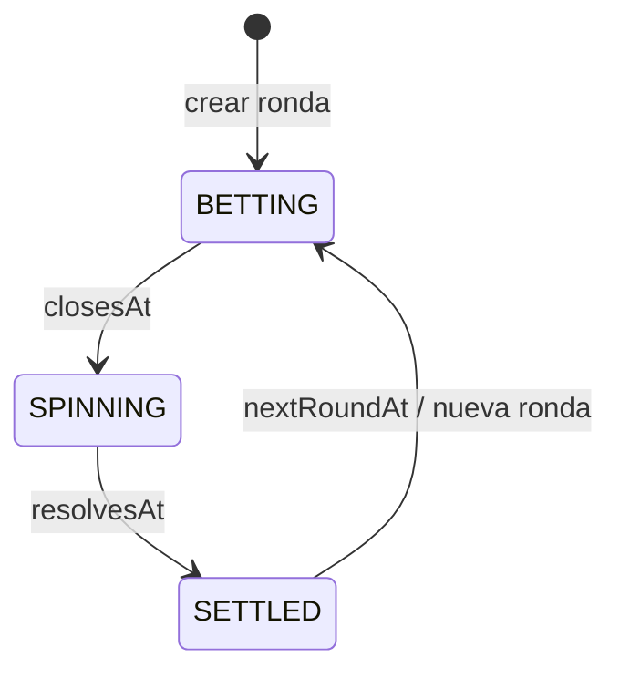

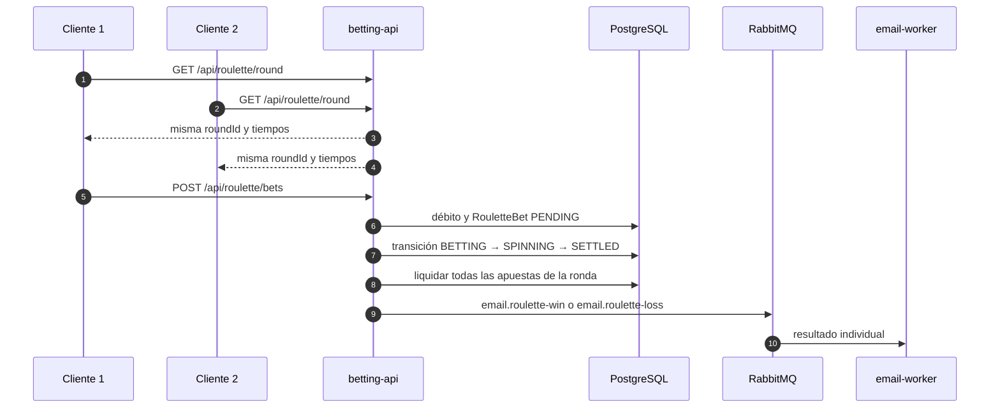

## 13. Modelo entidad-relación

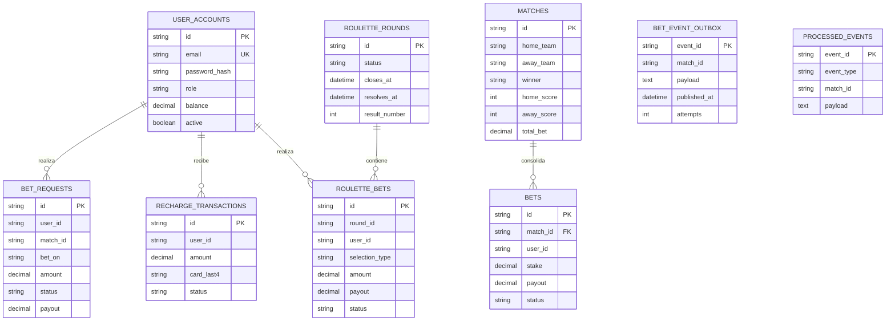

## 14. Despliegue en AWS

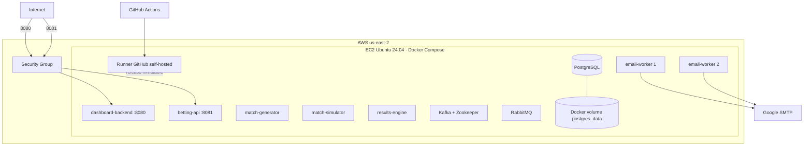

## 15. Segmentación de red

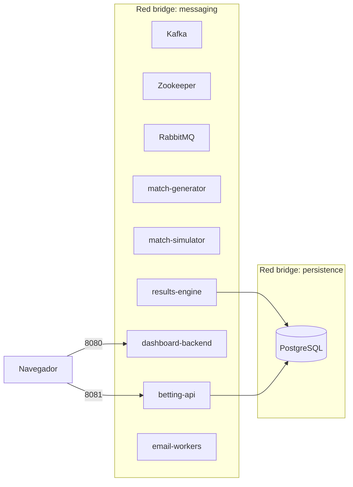

## 16. Pipeline CI/CD

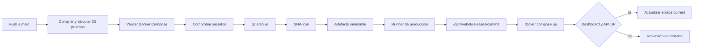

## 17. Recuperación e idempotencia

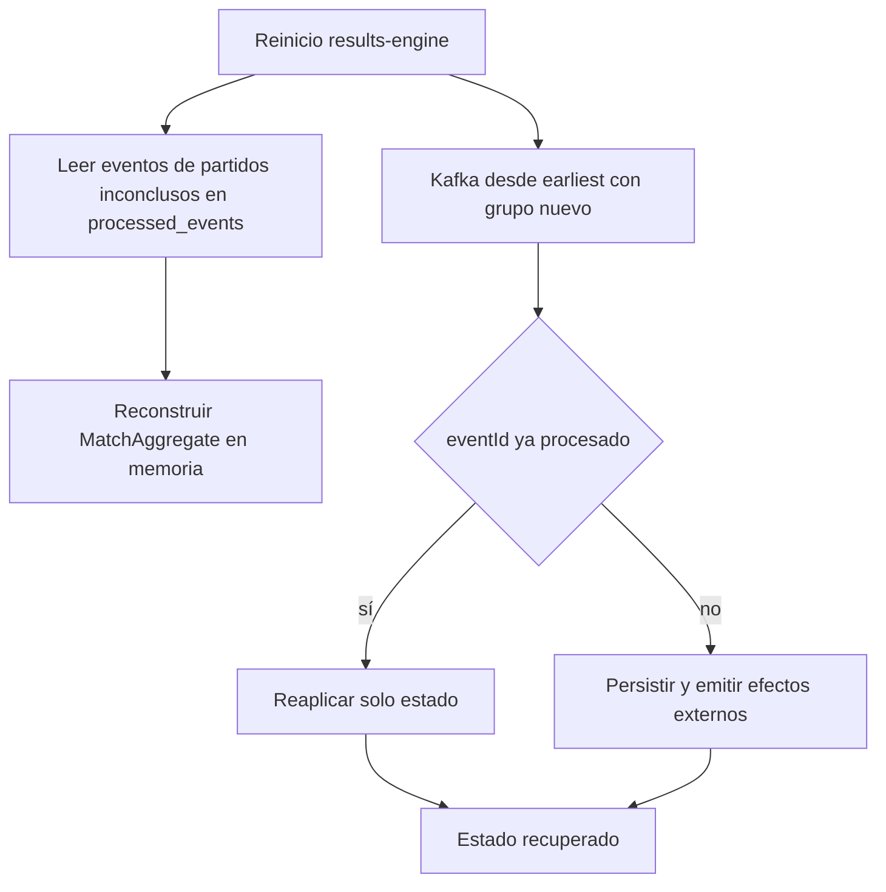
