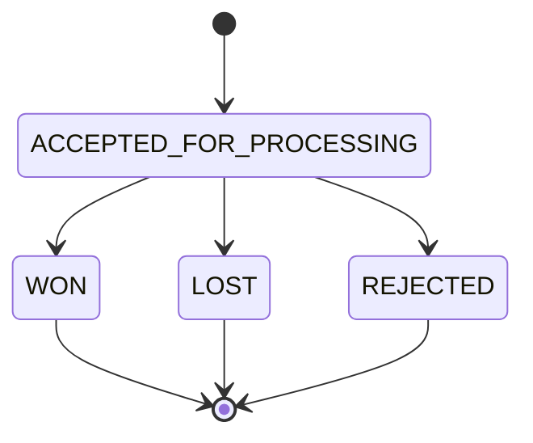

# Modelo de datos y persistencia

## 1. Estrategia general

LiveBet utiliza PostgreSQL para dos propósitos distintos:

1. **Datos operativos:** usuarios, saldos, solicitudes de apuesta, outbox, recargas y ruleta.
2. **Auditoría consolidada:** partidos, apuestas procesadas y eventos consumidos.

Kafka continúa siendo la fuente ordenada de eventos de partidos. PostgreSQL ofrece consultas, transacciones financieras e idempotencia durable.

## 2. Propiedad de los datos

Aunque la entrega usa una instancia PostgreSQL compartida, cada servicio escribe solamente sus tablas:

| Servicio | Tablas que escribe |
|---|---|
| `betting-api` | `user_accounts`, `bet_requests`, `bet_event_outbox`, `recharge_transactions`, `roulette_rounds`, `roulette_bets` |
| `results-engine` | `matches`, `bets`, `processed_events` |

`dashboard-backend`, `match-generator`, `match-simulator` y `email-worker` no acceden a PostgreSQL.

## 3. Diagrama relacional

Consulte el [diagrama ER](diagramas.md#13-modelo-entidad-relación).

Las relaciones de negocio entre cuentas y solicitudes se conservan por identificadores, aunque no todas se expresan como foreign keys JPA. Esto reduce el acoplamiento entre modelos que pertenecen a servicios diferentes, pero exige validación desde la capa de aplicación.

## 4. Catálogo de tablas

### 4.1 `user_accounts`

Propietario: `betting-api`.

| Columna | Tipo lógico | Restricción | Uso |
|---|---|---|---|
| `id` | string | PK | `u-` + UUID corto |
| `name` | string(80) | no nulo | Nombre visible |
| `email` | string(160) | no nulo, único | Login y notificaciones |
| `password_hash` | string | no nulo | BCrypt, nunca contraseña plana |
| `role` | enum | no nulo | `USER` o `ADMIN` |
| `balance` | decimal(19,2) | no nulo | Saldo demo en COP |
| `active` | boolean | no nulo | Control administrativo |
| `created_at` | timestamp | no nulo | Auditoría |

Invariantes:

- correo normalizado a minúsculas;
- débito y crédito estrictamente positivos;
- ningún débito puede dejar saldo negativo;
- una cuenta inactiva no mueve saldo.

### 4.2 `bet_requests`

Representa la solicitud y su efecto contable desde la perspectiva de la cuenta.

| Columna | Uso |
|---|---|
| `id` | Identificador `b-...` |
| `user_id` | Usuario propietario |
| `match_id` | Partido seleccionado |
| `bet_on` | Equipo elegido |
| `amount` | Stake debitado |
| `status` | Estado de procesamiento |
| `payout` | Premio acreditado, cero si pierde |
| `created_at` | Creación |
| `settled_at` | Liquidación o rechazo |

Transiciones:



Una transición terminal solo se ejecuta si `pending()` continúa siendo verdadera.

### 4.3 `bet_event_outbox`

Garantiza consistencia entre PostgreSQL y Kafka.

| Columna | Uso |
|---|---|
| `event_id` | PK e identificador idempotente |
| `match_id` | Key Kafka |
| `payload` | JSON completo de `BET_PLACED` |
| `created_at` | Orden de despacho |
| `published_at` | Nulo hasta confirmar publicación |
| `attempts` | Intentos fallidos |
| `last_error` | Diagnóstico acotado a 500 caracteres |

El índice `idx_outbox_pending(publishedAt, createdAt)` acelera la lectura de pendientes.

### 4.4 `matches`

Auditoría consolidada creada al terminar el partido.

| Columna | Uso |
|---|---|
| `id` | `matchId` |
| `home_team` / `away_team` | Participantes |
| `status` | Estado final, normalmente `SETTLED` |
| `winner` | Ganador |
| `home_score` / `away_score` | Marcador |
| `total_bet` | Suma de stakes aceptados |
| `closed_at` | Fecha de consolidación |

### 4.5 `bets`

Detalle auditado por el motor de resultados.

| Columna | Uso |
|---|---|
| `id` | `betId` |
| `match_id` | FK opcional a `matches` |
| `user_id` | Apostador |
| `bet_on` | Equipo seleccionado |
| `stake` | Importe |
| `winner` | Indicador de acierto |
| `payout` | Dividendo calculado |
| `status` | `WON`, `LOST` o `REJECTED` |
| `rejection_reason` | Motivo de rechazo tardío |

Las apuestas liquidadas se agregan en cascada desde `MatchAuditEntity`. Una apuesta rechazada puede guardarse sin relación a un partido consolidado.

### 4.6 `processed_events`

Inbox idempotente y copia auditable del payload consumido.

| Columna | Uso |
|---|---|
| `event_id` | PK, evita efectos duplicados |
| `event_type` | Tipo lógico |
| `match_id` | Agrupación por agregado |
| `processed_at` | Momento de procesamiento inicial |
| `payload` | JSON original |

Esta tabla permite recuperar eventos de partidos inconclusos y distingue primera ejecución de relectura.

### 4.7 `recharge_transactions`

| Columna | Uso |
|---|---|
| `id` | Referencia del recibo `r-...` |
| `user_id` | Cuenta abonada |
| `amount` | Valor aprobado |
| `cardholder` | Nombre indicado |
| `card_last4` | Único fragmento conservado de la tarjeta |
| `status` | `APPROVED` |
| `processed_at` | Fecha de la simulación |

Por diseño no existen columnas para PAN completo, fecha o CVV.

### 4.8 `roulette_rounds`

| Columna | Uso |
|---|---|
| `id` | Ronda global |
| `status` | `BETTING`, `SPINNING`, `SETTLED` |
| `opened_at` | Inicio |
| `closes_at` | Cierre de apuestas |
| `resolves_at` | Presentación del resultado |
| `next_round_at` | Inicio de siguiente ronda |
| `result_number` | Número europeo 0–36 |

### 4.9 `roulette_bets`

| Columna | Uso |
|---|---|
| `id` | `rb-...` |
| `round_id` | Ronda |
| `user_id` | Cuenta |
| `selection_type` | NUMBER, COLOR, PARITY, RANGE o DOZEN |
| `selection_value` | Valor normalizado |
| `selection_label` | Texto para interfaz y correo |
| `amount` | Stake |
| `payout` | Premio |
| `status` | `PENDING`, `WON` o `LOST` |
| `created_at` | Fecha de apuesta |

## 5. Límites transaccionales

### Apuesta deportiva

Una transacción incluye:

- bloqueo/carga de cuenta;
- débito;
- inserción de `bet_requests`;
- inserción de `bet_event_outbox`.

Kafka no forma parte de la transacción; el outbox resuelve esa separación.

### Recarga

Una transacción incluye:

- crédito de cuenta;
- inserción de `recharge_transactions`.

La notificación de correo se publica después de ejecutar la lógica de cuenta. Para una garantía estricta entre base y RabbitMQ podría añadirse un outbox de notificaciones.

### Ruleta

La colocación de apuesta debita cuenta y guarda `roulette_bets` en una transacción. La liquidación recorre apuestas pendientes, calcula payout y acredita ganadores.

### Resultado deportivo

`EventProcessor.process` se ejecuta transaccionalmente. En la primera ejecución persiste auditoría y `processed_events`. Las notificaciones RabbitMQ no participan de una transacción distribuida; la idempotencia reduce duplicados, pero una arquitectura de producción podría usar outbox también aquí.

## 6. Precisión financiera

- Java usa `BigDecimal`.
- `Money` normaliza a escala 2 con `HALF_UP`.
- PostgreSQL usa precisión `19,2` para cuentas y transacciones.
- Nunca se usa `double` para saldos.
- La cuota fija actual es `2.0`.

## 7. Retención y respaldo

- Kafka retiene `match_events` durante siete días en la configuración actual.
- PostgreSQL usa el volumen nombrado `postgres_data`.
- Un despliegue de código no elimina el volumen.
- `docker compose down -v` elimina datos y solo debe usarse intencionalmente.
- Para producción se recomienda `pg_dump` periódico, cifrado y almacenado fuera de la EC2.

## 8. Migraciones

Actualmente Hibernate utiliza `ddl-auto=update`, apropiado para la demostración. La evolución recomendada es:

1. introducir Flyway;
2. crear una línea base del esquema;
3. versionar cada cambio SQL;
4. ejecutar migraciones antes de aceptar tráfico;
5. impedir cambios automáticos de Hibernate en producción.

## 9. Consultas de auditoría

Últimos partidos:

```sql
select id, home_team, away_team, winner, home_score, away_score,
       total_bet, closed_at
from matches
order by closed_at desc
limit 20;
```

Apuestas por partido:

```sql
select id, user_id, bet_on, stake, status, payout, rejection_reason
from bets
where match_id = 'm-a1b2c3d4';
```

Outbox pendiente:

```sql
select event_id, match_id, created_at, attempts, last_error
from bet_event_outbox
where published_at is null
order by created_at;
```

Eventos auditados:

```sql
select event_id, event_type, match_id, processed_at
from processed_events
where match_id = 'm-a1b2c3d4'
order by processed_at;
```

No deben ejecutarse consultas que expongan `password_hash` ni copiar payloads con datos personales fuera del entorno académico.
