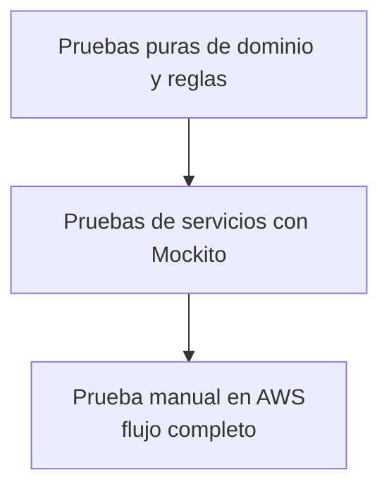

# Estrategia de pruebas y trazabilidad de requisitos

## 1. Objetivo

La estrategia comprueba reglas de negocio y coordinación sin iniciar contextos Spring, contenedores, sockets o brokers. Esto mantiene las pruebas rápidas, deterministas y apropiadas para CI.

Estado verificado de la suite:

- 14 clases de prueba;
- 33 casos `@Test`;
- 0 fallos;
- 0 errores;
- 0 omitidos;
- ejecución completa aproximada: 8–10 segundos con dependencias cacheadas.

## 2. Ejecución

Con Maven instalado:

```bash
mvn -B test
```

Sin Maven local:

```bash
docker run --rm \
  -v maven-cache:/root/.m2 \
  -v "$PWD":/workspace \
  -w /workspace \
  maven:3.9.9-eclipse-temurin-17 \
  mvn -B test
```

Validación equivalente al pipeline:

```bash
mvn -B verify
docker compose config --quiet
```

## 3. Pirámide de pruebas actual



La entrega privilegia pruebas unitarias aisladas porque así lo exige el enunciado. Las pruebas de integración con Testcontainers son una evolución recomendada.

## 4. Catálogo de pruebas

### 4.1 Dominio

#### `MatchAggregateTest`

- acepta una apuesta válida mientras está abierto;
- rechaza una apuesta después del cierre;
- calcula el premio ganador mediante Strategy;
- rechaza dinero negativo.

Demuestra modelo rico, State, Strategy y Fail-Fast.

### 4.2 Generador

#### `MatchEventPublisherTest`

- verifica exactamente una publicación de evento;
- verifica exactamente una programación de temporizador;
- comprueba el delay entregado al puerto.

Los puertos están simulados, sin Kafka ni RabbitMQ reales.

### 4.3 Betting API

#### `BetServiceTest`

- guarda solicitud;
- debita saldo;
- encola evento en outbox;
- devuelve identificador y saldo.

#### `BetOutboxDispatcherTest`

- publica un evento pendiente;
- verifica interacción con el publisher;
- marca el mensaje como enviado.

#### `SettlementServiceTest`

- acredita ganancia;
- marca pérdida sin acreditar;
- reembolsa apuesta rechazada;
- protege estados terminales.

#### `UserAccountTest`

- valida débito y crédito;
- evita saldo insuficiente y movimientos inválidos.

#### `TokenServiceTest`

- emite y verifica token válido;
- rechaza token alterado.

#### `RechargeServiceTest`

- acredita la cuenta;
- persiste referencia y últimos cuatro dígitos;
- publica recibo por correo;
- valida formatos y montos.

#### `RouletteRulesTest`

- valida apuestas por número;
- valida color, paridad, rango o docena;
- verifica multiplicadores y resultados.

### 4.4 Simulador

#### `SimulationWorkerTest`

- genera marcador válido;
- evita empate en el contrato final;
- publica un único `MATCH_FINISHED`.

### 4.5 Motor de resultados

#### `EventProcessorTest`

- reconstruye secuencia completa;
- guarda partido consolidado;
- envía notificación ganadora;
- actualiza dashboard;
- rechaza apuesta tardía;
- guarda auditoría del rechazo;
- evita efectos al reprocesar.

### 4.6 Dashboard

#### `DashboardListenerTest`

- almacena y difunde una actualización;
- impide que un mensaje antiguo reabra un partido terminado;
- limita la ventana de partidos históricos.

#### `StateControllerTest`

- excluye partidos abiertos vencidos después de la gracia de liquidación.

### 4.7 Correo

#### `EmailTemplateRendererTest`

- renderiza ganancia;
- renderiza pérdida;
- renderiza rechazo/reembolso;
- renderiza recarga;
- renderiza resultado de ruleta;
- genera contenido HTML y texto con datos relevantes.

## 5. Matriz requisito–evidencia

| Requisito del ejercicio | Implementación | Prueba/evidencia | Estado |
|---|---|---|---:|
| Generar partidos aleatorios | `RandomMatchScheduler` | Logs y dashboard | ✅ |
| Kafka como log | `match_events` | Compose y adaptadores | ✅ |
| Key por partido | `KafkaTemplate.send(topic, matchId, ...)` | Revisión de código | ✅ |
| Consumidor stateful | `MatchRegistry` | `EventProcessorTest` | ✅ |
| Temporizador diferido | `RabbitMatchTimerAdapter` | `MatchEventPublisherTest` | ✅ |
| Simulación de resultado | `SimulationWorker` | `SimulationWorkerTest` | ✅ |
| Rechazo tardío | `MatchState` | `MatchAggregateTest`, `EventProcessorTest` | ✅ |
| State | Estados del dominio | `MatchAggregateTest` | ✅ |
| Strategy | `PayoutStrategy` | `MatchAggregateTest` | ✅ |
| Value Objects | Records del dominio | `MatchAggregateTest` | ✅ |
| DIP | Puertos y adaptadores | Tests con mocks | ✅ |
| Persistencia histórica | Entidades JPA | `EventProcessorTest` | ✅ |
| Liquidación transaccional | Handlers y reconciliador | `SettlementServiceTest` | ✅ |
| Topic Exchange | `notifications` | Configuración Rabbit | ✅ |
| Dashboard WebSocket | `DashboardSocketHandler` | `DashboardListenerTest` | ✅ |
| Email concurrente | dos réplicas | Compose y logs | ✅ |
| Docker multietapa | seis Dockerfiles | Pipeline/inspección | ✅ |
| Usuario no root | `USER appuser` | Dockerfiles | ✅ |
| Límites de hardware | `deploy.resources.limits` | `docker compose config` | ✅ |
| Tests aislados | sin `@SpringBootTest` | suite completa | ✅ |

## 6. Criterios de aceptación funcional

### Registro y login

- Dado un correo nuevo, al registrarse se crea cuenta USER activa con 250.000 COP.
- Dado un correo repetido, se devuelve conflicto.
- Dada contraseña errónea, no se entrega token.
- Dada cuenta inactiva, el login falla.

### Apuesta deportiva

- Dado saldo suficiente y request válido, se descuenta el monto y se crea outbox.
- Dado saldo insuficiente, no cambia cuenta ni se crea apuesta.
- Dado partido abierto, el motor incorpora la apuesta.
- Dado partido finalizado, el motor rechaza y el saldo se reembolsa una sola vez.
- Dada apuesta ganadora, se acredita stake × 2.
- Dada apuesta perdedora, el saldo no recibe premio.

### Recarga

- Dado un número ficticio de 16 cifras y monto válido, se acredita saldo.
- Solo se guardan últimos cuatro dígitos.
- Se genera un recibo y una notificación.
- Un formato inválido no modifica el saldo.

### Ruleta

- Todos los clientes observan la misma `roundId`.
- Solo se apuesta durante `BETTING`.
- El débito y la apuesta son atómicos.
- El número resultante pertenece a 0–36.
- Cada apuesta termina `WON` o `LOST`.
- El correo se emite en ambos resultados.

### Dashboard

- Un partido creado aparece abierto.
- Una apuesta incrementa contador y total.
- Un partido finalizado muestra marcador y ganador.
- Un mensaje viejo no reabre el partido.
- Un partido vencido no permanece indefinidamente como abierto.

## 7. Pruebas manuales de humo

### Infraestructura

```bash
./scripts/verify.sh
docker compose ps
```

Esperado: dashboard y API `UP`; brokers y base saludables.

### Dashboard

```bash
curl -fsS http://localhost:8080/api/matches
```

Esperado: JSON con partidos y ningún abierto vencido fuera de la gracia.

### Seguridad

Sin token:

```bash
curl -i http://localhost:8081/api/bets
```

Esperado: `401`.

Usuario normal sobre administración:

```bash
curl -i -H "Authorization: Bearer $TOKEN" http://localhost:8081/api/admin/users
```

Esperado: `403`.

### Flujo de apuesta

1. registrar usuario;
2. copiar token;
3. escoger partido abierto;
4. apostar;
5. comprobar débito;
6. esperar cierre;
7. comprobar estado, saldo y correo.

## 8. Evidencia de producción

La comprobación más reciente confirmó:

- dashboard Actuator: `UP`;
- API Actuator: `UP`;
- Docker Compose válido;
- pipeline completo exitoso;
- 0 partidos abiertos vencidos fuera de la ventana de cierre;
- historial de despliegues exitosos en GitHub Actions.

## 9. Calidad del pipeline

El job de pruebas falla si:

- Maven no compila;
- una prueba falla;
- Docker Compose no es válido;
- `.env` está versionado;
- encuentra patrones simples de secretos prohibidos.

El despliegue solo se ejecuta después de las pruebas y utiliza el mismo commit aprobado.

## 10. Pruebas futuras recomendadas

### Integración

- Testcontainers Kafka: orden por key y replay.
- Testcontainers RabbitMQ con plugin delayed.
- Testcontainers PostgreSQL: transacciones y constraints.
- SMTP falso con GreenMail o MailHog.

### Contratos

- Compatibilidad JSON de eventos.
- Esquemas JSON versionados.
- Pruebas de routing keys y bindings.

### End-to-end

- Playwright para registro, apuesta, historial y recarga.
- Dos navegadores validando la misma ruleta.
- Reinicio del motor durante un partido.
- Caída temporal de Kafka durante publicación del outbox.

### No funcionales

- Carga de API con múltiples apuestas concurrentes.
- Resistencia de saldo ante doble submit.
- Tiempo de recuperación del motor.
- Consumo de memoria bajo límites Docker.

## 11. Cobertura

La suite cuenta casos, pero todavía no calcula porcentaje de cobertura. Se recomienda JaCoCo con objetivos iniciales:

- dominio: 90 % de líneas y ramas;
- servicios: 80 %;
- adaptadores: 70 %;
- cobertura global: 80 %.

El porcentaje no sustituye pruebas significativas; debe complementarse con casos de invariantes y fallos.

## 12. Definición de terminado

Un cambio se considera terminado cuando:

- [ ] compila con Java 17;
- [ ] incluye o actualiza pruebas;
- [ ] las 33 pruebas existentes continúan pasando;
- [ ] `docker compose config --quiet` pasa;
- [ ] no agrega secretos;
- [ ] actualiza contratos y documentación afectados;
- [ ] conserva idempotencia y estados terminales;
- [ ] despliega y supera health checks;
- [ ] no deja partidos o apuestas en estados indefinidos.
